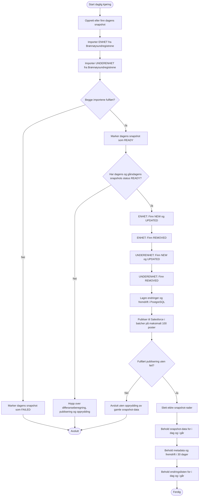

# EREG Salesforce v2

En Kotlin-tjeneste som importerer daglige, fullstendige øyeblikksbilder fra Brønnøysundregistrenes Enhetsregister, sammenligner dagens øyeblikksbilde med gårsdagens og publiserer nye, oppdaterte og fjernede enheter til Salesforce.

Tjenesten lagrer øyeblikksbilder og fremdriftsinformasjon i PostgreSQL. Den tilbyr også interne endepunkter for status og databasediagnostikk, samt et enkelt grafisk grensesnitt for å inspisere data fra øyeblikksbildene og tilhørende endringer.

## Dette gjør tjenesten

### 1. Importerer data fra Enhetsregisteret

Tjenesten laster ned de gzip-komprimerte JSON-eksportene fra Brønnøysundregistrene:

- ENHET: `https://data.brreg.no/enhetsregisteret/api/enheter/lastned`
- UNDERENHET: `https://data.brreg.no/enhetsregisteret/api/underenheter/lastned`

Filene kan være store, og derfor behandles de som strømmer i stedet for å lastes inn i minnet i sin helhet. Hver enhet parses og lagres i batcher på 2 000 rader. Den lagrede raden inneholder snapshotdato, organisasjonsnummer, navn, registreringsdato, en SHA-256-hash av den parsede JSON-representasjonen og selve JSON-payloaden. Når Brønnøysundregistrene oppgir HTTP-headerne `ETag` og `Last-Modified`, logges disse også.

Et øyeblikksbilde får status `READY` først når importen av både ENHET og UNDERENHET er fullført. Ved feil settes status til `FAILED`.

### 2. Beregner daglige endringer

En vanlig daglig kjøring sammenligner dagens øyeblikksbilde med gårsdagens, forutsatt at begge har status `READY`. Sammenligningen gjennomføres i fire deterministiske passeringer:

1. **ENHET – finnes i dagens øyeblikksbilde:** Finn `NEW` og `UPDATED` ved å sammenligne organisasjonsnumre og payload-hasher.
2. **ENHET – finnes i gårsdagens øyeblikksbilde:** Finn `REMOVED` når et organisasjonsnummer ikke lenger finnes i dagens data.
3. **UNDERENHET – finnes i dagens øyeblikksbilde:** Finn `NEW` og `UPDATED`.
4. **UNDERENHET – finnes i gårsdagens øyeblikksbilde:** Finn `REMOVED`.

Radene behandles i stigende rekkefølge etter organisasjonsnummer, i batcher på 2 000. Fremdrift per fase, antall behandlede endringer og sist behandlede organisasjonsnummer lagres i PostgreSQL. Organisasjonsnumrene som har endringer, lagres også separat. Dette gjør at det grafiske grensesnittet kan vise et utvalg av hver endringskategori uten å hente ut alle JSON-dataene fra øyeblikksbildene.

### 3. Publiserer endringer til Salesforce

Endringene sendes til Salesforce via Composite sObject REST API, med maksimalt 100 poster per batch. Applikasjonen kontrollerer både HTTP-responsen og resultatet for hver enkelt post fra Salesforce.

Meldingsformatet `KafkaMessage__c` beholdes:

- **`NEW` og `UPDATED`** bruker topic `public-ereg-cache-org-json`. Nøkkelen er `<orgNumber>#<orgType>#<payloadHash>`, og JSON-payloaden Base64-kodes i `CRM_Value__c`.
- **`REMOVED`** bruker topic `public-ereg-cache-org-tombstones`. Både `CRM_Key__c` og `CRM_Value__c` inneholder organisasjonsnummeret.

En vanlig kjøring forsøker bare å beregne og publisere endringer dersom både dagens og gårsdagens øyeblikksbilder har status `READY`. Opprydding kjøres bare dersom Salesforce-publiseringen fullføres uten feil.

### 4. Beholder øyeblikksbilder og driftshistorikk

Etter en vellykket daglig kjøring beholdes snapshot-radene for i dag og i går, mens eldre snapshot-rader slettes. Metadata og fremdriftsregistreringer beholdes for de siste 30 dagene. Den kompakte listen over organisasjoner med endringer beholdes for dagens og gårsdagens dato.

Sletting av rader i PostgreSQL reduserer ikke nødvendigvis den tildelte diskstørrelsen umiddelbart. PostgreSQL kan beholde den frigjorte plassen for senere gjenbruk. Databasdiagnostikkens oversikt over snapshotdatoer er den viktigste kontrollen for å verifisere at eldre snapshot-rader er slettet.

<strong>Flyt for daglig kjøring</strong>

